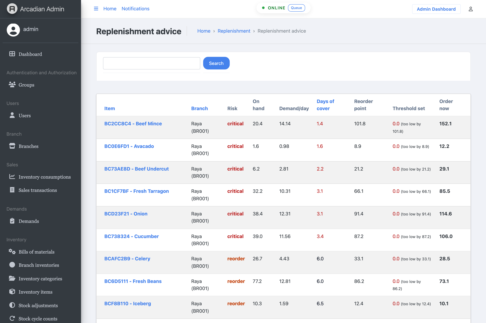
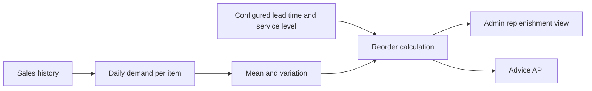

# Arcadian ERP

A Django ERP for a food business with several branches. It covers inventory, purchasing, sales, warehouse stock, branch-to-branch transfers and branch demand requests, mostly managed through a Jazzmin-styled Django admin with a small REST API alongside it.

It also includes a replenishment module that uses sales history to suggest reorder points for each stock item.



**Stack:** Python 3.12, Django, Django REST Framework, drf-spectacular, PostgreSQL, Celery with Redis, uv for dependencies, ruff for linting.

## Setup with Docker

```bash
cp .env.example .env    # set SECRET_KEY and DB_HOST=db
docker compose up -d
docker compose run --rm web uv run python manage.py migrate
docker compose run --rm web uv run python manage.py setup_dev
docker compose run --rm web uv run python manage.py seed_demand_history
```

Open http://localhost:8500/admin and log in with `admin` / `admin1234` (the defaults created by `setup_dev`).

The compose file also starts Redis, a Celery worker and Celery beat. There is a separate `docker-compose.dev.yml` with live reload, and the Makefile wraps it (`make docker-up`, `make docker-migrate`, `make docker-setup` and so on). Run `make help` to see every target.

## Setup without Docker

You need a local Postgres matching the `DB_*` values in `.env`.

```bash
uv sync
make migrate
make setup-first-time
make run
```

## Replenishment

`apps/replenishment/` builds a daily demand series per item from past sales (days with no sales count as zero) and calculates:

- mean and standard deviation of daily demand
- lead-time demand and safety stock (`z * stdev * sqrt(lead time)`)
- reorder point, days of cover and a suggested order quantity
- how far the item's configured `minimum_threshold` is from the calculated reorder point

The results show up in the admin and through the API:

```
GET /api/v1/replenishment/advice/?risk=critical&lead_time_days=5&service_level=0.95
```

Defaults are a 5 day lead time, 95% service level and 90 days of history. They can be changed per request. The calculation assumes roughly normal demand, so it's not a great fit for very slow-moving items, and lead time is passed in rather than measured from purchase orders.

## Apps

- `inventory`: items, categories, branch stock
- `sales`: POS transactions and inventory consumption
- `purchases`: purchase orders and goods receipts
- `warehouse`: warehouse stock and requests
- `transfers`: stock movement between branches
- `demands`: branch replenishment requests
- `replenishment`: reorder point analysis
- `reports`, `users`, `branch`, `products`, `payments`, `common`

More detail on individual workflows is in [docs/flows](docs/flows), and Docker and Makefile notes are in [docs/docker.md](docs/docker.md) and [docs/makefile.md](docs/makefile.md).

## Tests and linting

```bash
make test        # or: docker compose run --rm web uv run python manage.py test
make lint
make format
```

Most of the tests are in `apps/replenishment/tests.py` and cover the demand and reorder calculations.

## Replenishment data flow



Dependency updates were checked with the 27 replenishment tests on isolated
SQLite. Those tests exercise the calculations, not the complete purchasing, POS
or stock-transfer workflows. PostgreSQL and Redis remain required for the full
local stack described above.

## Author

[**Muhammad Nadeem**](https://github.com/dev-mnadeem)
