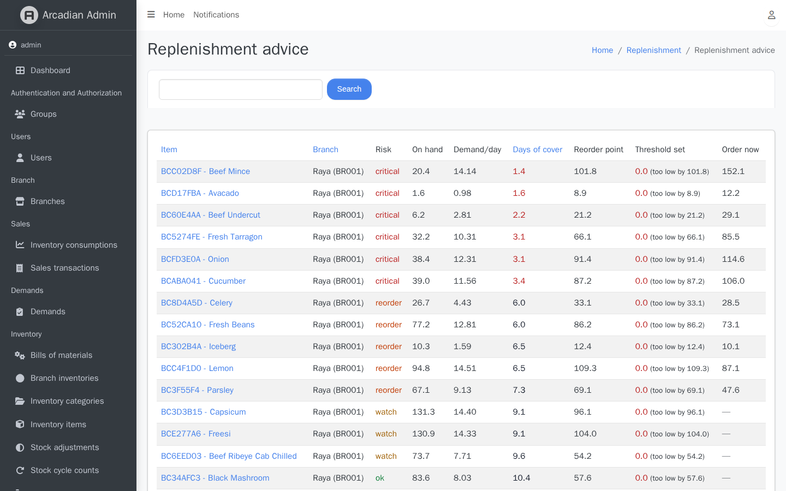
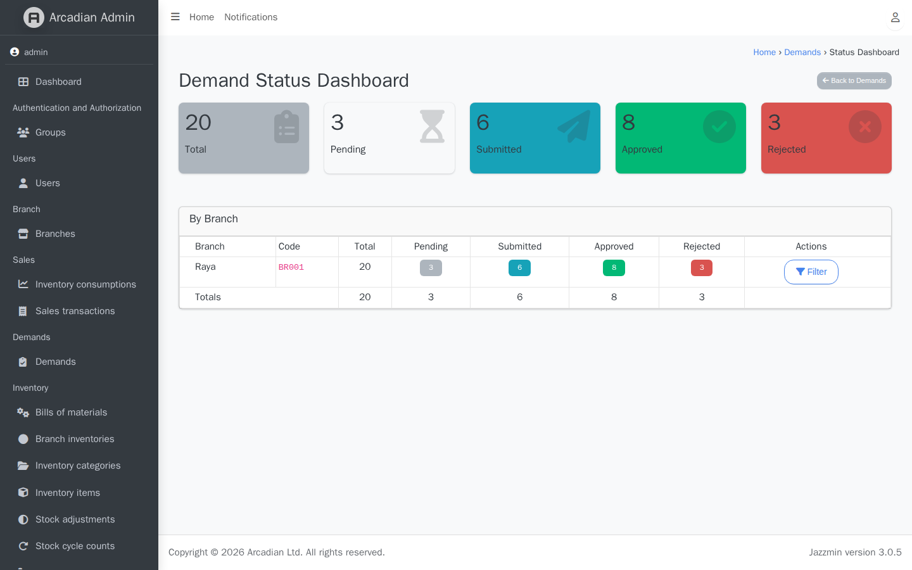
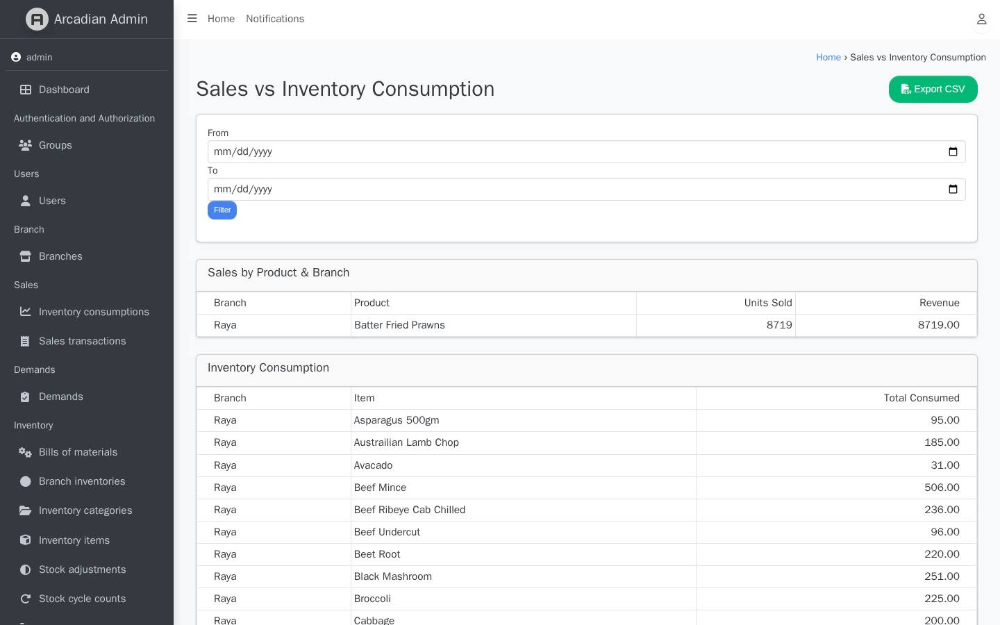
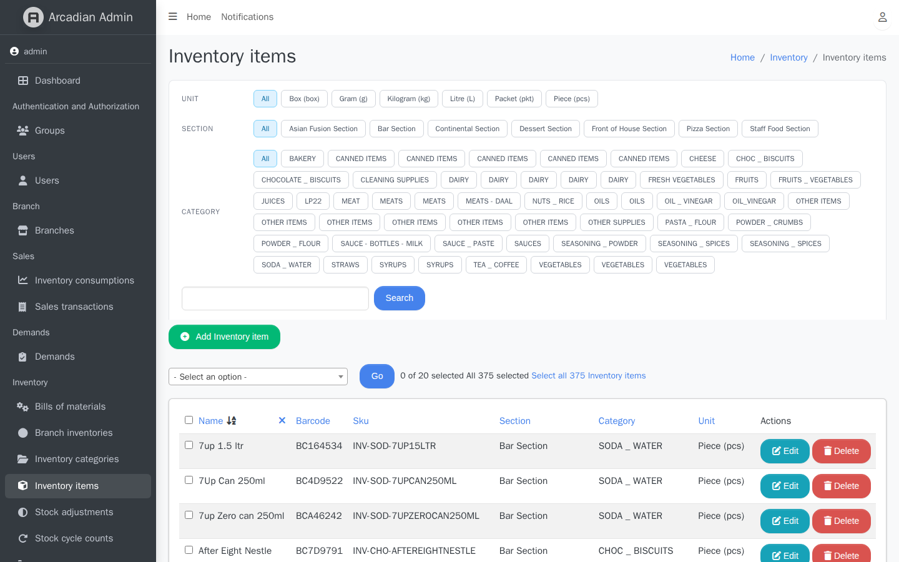
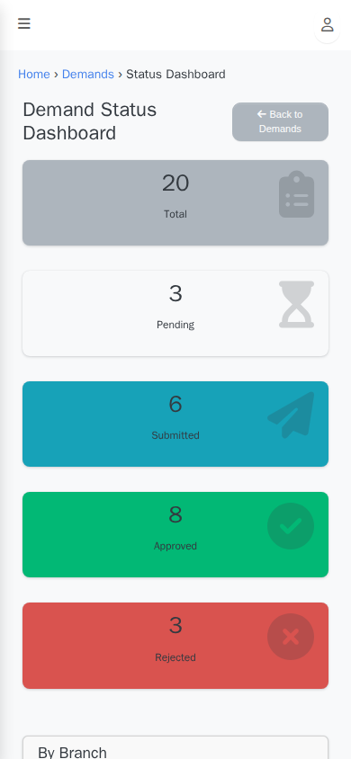
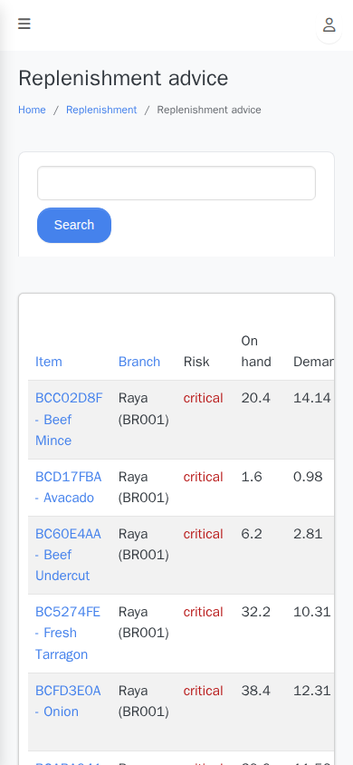
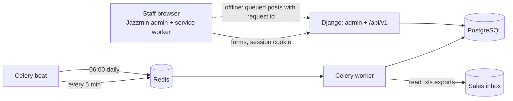
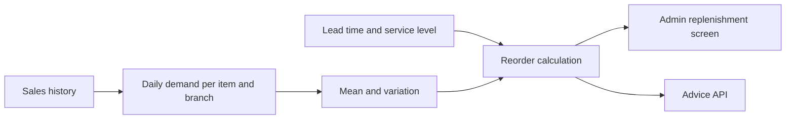

# Arcadian ERP

A Django back office for a food business with several branches and a central warehouse. It tracks stock per branch and per warehouse, and turns sales into ingredient consumption through bills of materials. It also covers purchasing and goods receipt, branch-to-branch and warehouse transfers, and branch demand requests. Each role gets reports and notifications for its own branches.

Almost everything happens in a Jazzmin-styled Django admin, with custom screens for receiving, dispatching, cycle counts and reconciliation. A small REST API serves barcode lookup, the offline admin's reference data and replenishment advice. The replenishment module turns 90 days of sales into a reorder point, days of cover and a suggested order for every stock row.



**Stack:** Python 3.12, Django 6.1, Django REST Framework, drf-spectacular, PostgreSQL 16, Celery 5.6 with Redis, gunicorn and whitenoise, uv for dependencies, ruff for linting.

## What it does

| Area | What happens |
|---|---|
| Inventory | Items with auto-generated `BC…` barcodes, sections and categories, stock per branch and per warehouse, cycle counts scheduled daily, weekly or monthly, and manual adjustments |
| Sales | A Celery beat job polls an IMAP inbox every 5 minutes for `.xls` sales exports. Each sale deducts its product's bill of materials from the branch, with unit conversion (250 g of cheese per pizza, stock kept in kg) |
| Demands | Branch managers raise demands, purchasers approve (possibly partially) or reject them, and goods receipts record what arrived |
| Purchasing | Vendors, purchase orders, goods receipts with per-line variance, and receipt photos (Cloudinary when configured) |
| Warehouse | Warehouse stock, inward/outward/adjustment transactions, and branch requests that move stock to the branch when approved |
| Transfers | Branch or warehouse to branch or warehouse, with barcode-assisted dispatch and receive screens |
| Reports | Sales vs consumption, item usage, demand vs received, demand vs usage, warehouse and branch stock, all exportable to CSV; an audit log of admin actions |
| Offline admin | A service worker queues form posts while offline and replays them on reconnect. Each replay carries a request id, so a post whose first response was lost is not applied twice |
| Replenishment | Reorder point, safety stock, days of cover and a suggested order per item and branch (see below) |

| Demand dashboard | Sales vs consumption report |
|---|---|
|  |  |

Inventory list with section and category filters:



The admin is usable on a phone; wide tables scroll sideways:

| | |
|---|---|
|  |  |

## Quick start (Docker)

You need Docker with Compose v2.

```bash
cp .env.example .env
# Set SECRET_KEY in .env, e.g. to the output of: python3 scripts/generate_secret_key.py
# Optionally set DEV_ADMIN_PASSWORD; otherwise setup_dev prints a generated one.

docker compose up -d --build
docker compose exec web python manage.py setup_dev --skip-migrate
docker compose exec web python manage.py seed_demand_history   # optional, fills replenishment
```

Open http://localhost:8500/admin and log in as `admin`. The password is `DEV_ADMIN_PASSWORD`, or the one `setup_dev` printed.

`docker-compose.yml` runs gunicorn, which migrates and collects static files on start, plus Postgres, Redis, a Celery worker and Celery beat. `setup_dev` creates the role groups, the superuser, one branch (`BR001`) with demo users `bm` and `purchaser`, 375 inventory items, the product menu, and a few months of Faker transactions. `seed_demand_history` adds 120 days of realistic daily sales for 40 items, so the replenishment figures mean something.

For development with live reload there is `docker-compose.dev.yml`, wrapped by the Makefile (`make docker-up`, `make docker-setup`, `make docker-seed-history`). It serves on http://localhost:8000. See [docs/docker.md](docs/docker.md) and [docs/makefile.md](docs/makefile.md).

### Without Docker

You need Python 3.12, uv and a Postgres matching the `DB_*` values in `.env`. With `DB_ENGINE` unset, Django falls back to a local SQLite file, which is enough for a quick look.

```bash
uv sync
make setup-first-time   # migrate, groups, superuser, seed data, demo transactions
make run
```

## How the pieces fit



Stock is never edited directly by these flows. Model signals apply each movement when the business event happens:

| Event | Stock effect |
|---|---|
| Sale imported | Branch stock minus BOM quantity × conversion factor × units sold, recorded as `InventoryConsumption` |
| Goods receipt line saved, edited or deleted | Branch stock adjusted by the change in received quantity |
| Transfer becomes *dispatched* / *received* | Source minus dispatched quantity / destination plus received quantity |
| Warehouse request approved | Warehouse outward transaction, branch stock plus the requested quantity |
| Warehouse transaction | Warehouse stock plus (inward, adjustment) or minus (outward) |
| Stock adjustment | Branch or warehouse stock plus (increase, correction) or minus (decrease) |

## Roles

Groups and their permissions come from `manage.py create_default_groups`, which `setup_dev` runs.

| Role | Sees and does |
|---|---|
| Admin | Everything, across all branches and warehouses; the only role with sales and usage reports |
| Branch Manager | Their branch: stock, demands, goods receipts, cycle counts, adjustments, transfers in and out |
| Purchaser | Approves or rejects demands for the branches they buy for; vendors and purchase orders |
| Warehouse Manager | Their warehouse: stock, transactions, branch requests, transfers |

The API uses the same scoping. `apps.permissions.visible_branch_codes()` decides which branches' stock a user may see.

## API

All endpoints except `ping` need a logged-in session. The OpenAPI schema is at `/api/v1/schema/`.

| Endpoint | Purpose |
|---|---|
| `GET /api/v1/ping/` | Connectivity check for the offline UI |
| `GET /api/v1/snapshot/?since=<iso>` | Items, stock, branches and warehouses the user may see, for offline use; `since` returns only changed rows |
| `GET /api/v1/items/barcode/<barcode>/` | Item details plus stock for the caller's scope: all branches for admins, own branch for managers, none for purchasers |
| `GET /api/v1/replenishment/advice/` | Ranked reorder advice; filters `branch`, `risk`, `lead_time_days`, `service_level`, `history_days`, `limit` |

Captured from the Compose stack after `setup_dev` and `seed_demand_history`, logged in as the admin:

```
GET /api/v1/replenishment/advice/?risk=critical&limit=1   -> 200
```
```json
{
  "parameters": {"lead_time_days": 5, "service_level": 0.95, "history_days": 90},
  "count": 1,
  "results": [
    {
      "item_id": 2,
      "item": "Beef Mince",
      "branch": "Raya (BR001)",
      "risk": "critical",
      "on_hand": 20.44,
      "mean_daily_demand": 14.144,
      "stdev_daily_demand": 8.453,
      "days_of_cover": 1.4,
      "projected_stockout": "2026-11-10",
      "lead_time_demand": 70.72,
      "safety_stock": 31.09,
      "reorder_point": 101.81,
      "configured_threshold": 0.0,
      "threshold_error": 101.81,
      "suggested_order_quantity": 152.1,
      "days_observed": 90,
      "days_with_demand": 90,
      "enough_history": true
    }
  ]
}
```

```
GET /api/v1/items/barcode/BCC02D8F/   -> 200
```
```json
{
  "id": 2,
  "name": "Beef Mince",
  "barcode": "BCC02D8F",
  "sku": "INV-MEA-BEEFMINCE",
  "unit": "kg",
  "section": "Continental Section",
  "category": "MEATS",
  "stock": [
    {"branch__branch_code": "BR001", "branch__name": "Raya", "quantity": 20.44, "minimum_threshold": 0.0}
  ]
}
```

Errors are plain JSON: `GET /api/v1/items/barcode/BC000000/` returns 404 with `{"detail": "No item found for barcode 'BC000000'."}`, and `?limit=0` on the advice endpoint returns 400 with `{"detail": "limit must be at least 1."}`. Barcodes are generated, so yours will differ.

## Replenishment

`apps/replenishment/` builds a daily demand series per item and branch from past sales. Days with no sales count as zero. From the series it calculates:

- mean and standard deviation of daily demand
- lead-time demand and safety stock (`z * stdev * sqrt(lead time)`)
- reorder point, days of cover and a suggested order quantity
- how far the item's configured `minimum_threshold` is from the calculated reorder point



Defaults are a 5-day lead time, a 95% service level and 90 days of history, all changeable per request. Demand is dated by the sale, not by when the consumption row was written, so back-filled history lands on the right days. The whole ranking reads demand in one grouped query. The calculation assumes roughly normal demand, so it fits very slow-moving items poorly. Lead time is passed in rather than measured from purchase orders.

## Design notes

- **Stock moves on transitions, not on saves.** Transfer, receipt, cycle-count and warehouse-request handlers compare against the status captured in `pre_save`. Re-saving a received transfer to fix its notes does not credit the destination again.
- **Stock writes happen in SQL.** Signals update quantities with `F()` expressions, so the Celery import and the admin cannot overwrite each other's changes. `ATOMIC_REQUESTS` wraps each request, so a failed dispatch or receive leaves no half-moved stock.
- **Offline replays are idempotent.** `IdempotencyMiddleware` stores the first successful response to a POST that carries `X-Client-Request-ID`, redirects included, and replays it for retries. It uses Django's cache. With several gunicorn workers, configure a shared cache such as Redis, or retries can reach a worker that never saw the first request.
- **Replenishment is statistics, not a model.** The quantity it answers has a closed form, and the z-scores are a table in the code, so every number can be checked by hand.

## Configuration

`.env.example` lists every variable. The ones that change behaviour:

| Variable | Effect |
|---|---|
| `SECRET_KEY` | Required |
| `DATABASE_URL` | If set (e.g. on Heroku), overrides the `DB_*` values and requires SSL |
| `IMAP_HOST`, `IMAP_USER`, `IMAP_PASSWORD` | Turn on the sales email import; blank means the beat job logs and skips |
| `CLOUDINARY_*` | All three set means uploads go to Cloudinary; otherwise local `media/` |
| `EMAIL_BACKEND`, `EMAIL_HOST`, … | Notification email, configured as Django 6.1 `MAILERS`; the console backend by default |
| `DEV_ADMIN_PASSWORD`, `DEV_SEED_PASSWORD` | Passwords for the demo accounts; generated and printed when blank |

## Tests and linting

```bash
docker compose exec web python manage.py test   # 90 tests against Postgres
make test        # same suite locally (uv)
make lint        # ruff check
make format      # ruff format
```

The suite covers the stock signals for sales, receipts, transfers, adjustments and warehouse transactions. It also covers notification fan-out, branch scoping in the API and admin, idempotent replays, the sales attachment handling, the replenishment arithmetic and query, the OpenAPI schema, and an end-to-end run of `setup_dev`. The admin's custom templates are checked by rendering, not by browser tests.

## Limitations

- The sales importer reads one POS export layout by column position (from row 5: name, code, quantity, amount, outlet id). Re-importing the same file creates the sales again.
- Lead times are a request parameter; nothing measures supplier performance.
- A completed cycle count records and reports its variance but does not correct stock; that takes a separate stock adjustment.
- Media uploads go to local disk unless Cloudinary is configured, and the Compose files do not persist `media/`.

## Further docs

- [docs/flows](docs/flows): how each workflow (demands, receiving, transfers, warehouse, barcodes, cycle counts, roles) behaves in the admin
- [docs/docker.md](docs/docker.md) and [docs/makefile.md](docs/makefile.md): Docker and Makefile reference
- [docs/TODO.md](docs/TODO.md): feature status as tracked during development

## License

MIT, see [LICENSE](LICENSE).
